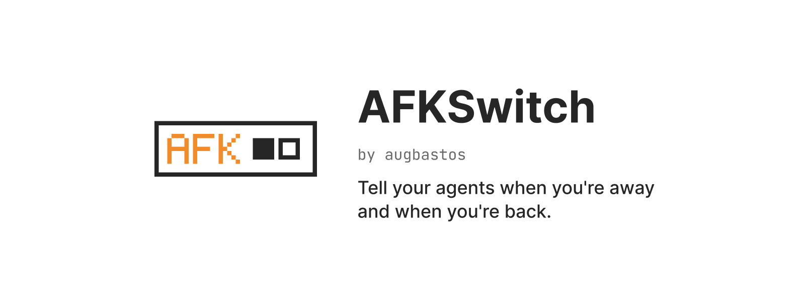
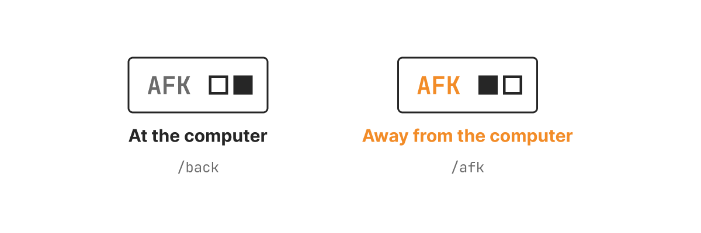
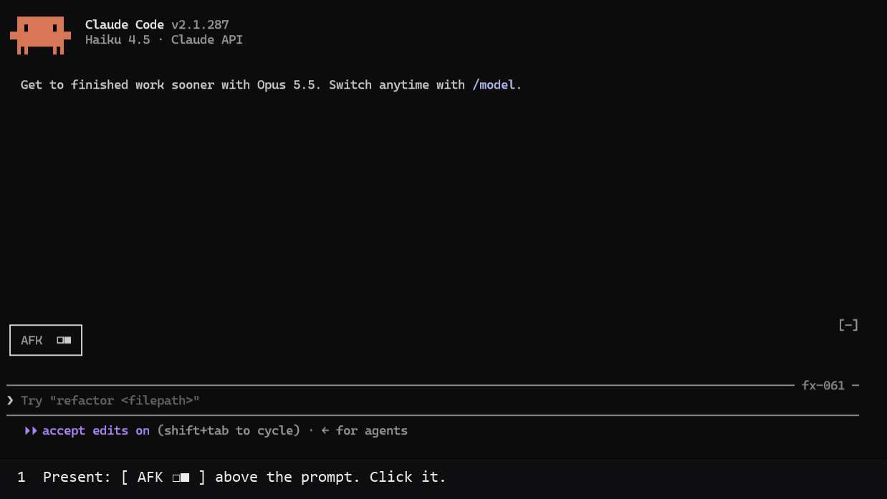

# AFKSwitch

<picture>
  <source media="(prefers-color-scheme: dark)" srcset="assets/readme/hero-dark.png">
  
</picture>

[](https://github.com/augbastos/afkswitch/actions/workflows/validate.yml)
[](LICENSE)
[](https://github.com/augbastos/afkswitch/releases)

**AFKSwitch by augbastos** — Tell your agents when you're away and when you're back.

AFKSwitch is a presence plugin for coding agents: mark yourself away, then return
to collect status where the host supports it. Presence is not permission.

## Status

Full support in Claude Code; Codex and Antigravity are state-only.
See [compatibility](#compatibility-at-a-glance).

### Compatibility at a glance

Capabilities from [the adapter matrix](adapters/capabilities.json):

| Host | State | Sync | Notify peers | Collect return status | Visual switch |
|---|---|---|---|---|---|
| Claude Code | yes | yes | yes | yes | terminal and desktop app, with modules |
| Codex | yes | no | no | no | no |
| Antigravity CLI | yes | no | no | no | no |
| Generic local agent | yes | before each turn, if the host calls the helper | no | no | no |

**Codex and Antigravity are state-only.** Their experimental hook files have no
default wiring or verified live-host sync. See [Codex installation](#codex) and
[tested versions and limits](docs/compatibility.md).

## What it does

```text
/afk [optional context]     I'm physically away
/back [optional context]    I'm physically present again
```

In Claude Code, `/afk` saves your presence and tells the live local sessions the host
can reach; the report names any it could not reach. Authorized work continues, and
only steps that need you wait. `/back` collects a summary with what needs you first,
then what got done. Optional context is information, never permission; `/back` context
belongs to that return event and is not saved in the state file.

While AFK, sessions keep a durable decision queue and record reversible choices within
existing authorization. Independent authorized work continues. At the next natural pause
after `/back`, each session presents all queued decisions together as multiple-choice
questions, recommended option first, then resumes asking in real time.

Click the terminal switch to run the same skills without context. Each invocation
starts a model turn; the host's permissions and costs still apply.

<picture>
  <source media="(prefers-color-scheme: dark)" srcset="assets/readme/states-dark.png">
  
</picture>

### What the switch runs by itself

The switch is a Claude Code mod (`hooks/switch.tsx`). It does these things and nothing else:

- **One slash command per click.** A click runs `/afkswitch:afk` when you are present, or
  `/afkswitch:back` when you are away, once. It never runs a command without a click.
- **It listens to `command.run`** only to notice when that command of its own starts. It
  passes every event on unchanged and does not see or change other commands.
- **It reads `HOME` or `USERPROFILE`** only to find `~/.afkswitch/state.json`
  (`AFKSWITCH_STATE_DIR` overrides the folder). These are folder paths, not credentials,
  and the mod sends nothing anywhere.
- **Two short timers** blink and then hide the idle label; nothing polls.

The three rules the plugin follows (one writer, explicit actions only, presence is not
permission) are in [details](docs/details.md#three-rules).

## Requirements

- `python3` (Python 3.9+) on `PATH`.
- For the switch: a Claude Code build with function hooks.
- On Windows, check that `python3 --version` answers: the Python install manager from
  python.org provides `python3`, the older classic installer provides only `python`.

AFKSwitch is a Claude Code Mod, live-tested on **2.1.287 on Windows**.
The [compatibility record](docs/compatibility.md) distinguishes local-marketplace
module loading from live clicks and peer notification.

## Install

For Claude Code:

```text
/plugin marketplace add augbastos/afkswitch
/plugin install afkswitch@afkswitch
/reload-plugins
```

If your build does not load installed mods, use the [local clone](#local-clone).
See [switch setup and behavior](docs/details.md#claude-code-visual-switch) for details.

### Local clone

```sh
git clone https://github.com/augbastos/afkswitch.git
claude --plugin-dir ./afkswitch
```

### Personal skills without the plugin

To get bare `/afk` and `/back` in every Claude Code session, copy the two skills into
`~/.claude/skills` (PowerShell 7). This does not install the switch.

```text
pwsh -File install.ps1              # install or update
pwsh -File install.ps1 -Uninstall   # remove
```

### Codex

```text
codex plugin marketplace add https://github.com/augbastos/afkswitch
codex plugin add afkswitch@afkswitch
```

Use `$afkswitch:afk` and `$afkswitch:back`. The state folder must be writable;
see [Codex sandbox setup](docs/details.md#codex-sandbox).

### Antigravity

There is no installer. The adapter is an experimental static layout that is not verified
in a live host; see [the Antigravity adapter](adapters/agy/README.md).

## Try it in 30 seconds

1. Open two Claude Code sessions in two terminals with AFKSwitch loaded.
2. Click the switch in one session to set AFK.
3. Watch the other session get told and continue its authorized work.
4. Click again to return and collect status.



## Test

Run from the repo root. Python 3.9 or newer; `pytest` is the only extra package.

```text
python scripts/validate.py
python -m pytest conformance -q -p no:cacheprovider
```

On a Claude Code build with function hooks, `claude plugin test .` runs the switch module
tests. The opt-in model evals in [`evals/`](evals/README.md) are not part of CI.
See [conformance](conformance/README.md) for what each check proves.

## Layout

| Path | What is in it |
|---|---|
| `skills/` | The `afk` and `back` skills and the bundled state helper |
| `hooks/` | Sync hooks and the Claude Code switch module (`switch.tsx`) |
| `adapters/` | Capability matrix and per-host adapters (generic, Antigravity) |
| `spec/` | The portable presence specification |
| `conformance/` | Model-independent tests and checker |
| `evals/` | Opt-in local model evals |
| `scripts/` | Validator, packager and logo generator |
| `docs/` | Details, compatibility record, history |
| `assets/` | Logos and README pictures |
| `.claude-plugin/`, `.codex-plugin/`, `plugin.json` | Plugin manifests |

## Configuration

| Variable | Effect |
|---|---|
| `AFKSWITCH_STATE_DIR` | Folder that holds `state.json` instead of `~/.afkswitch` |
| `AFKSWITCH_KEEP_PROMPTS=1` | Keep Claude Code approval prompts open while you are away |

## What AFKSwitch reads, writes, and sends

**Privacy:** state stays local in `~/.afkswitch/state.json`, or in `state.json` under
`AFKSWITCH_STATE_DIR` when set. It contains status, time, optional AFK context, and a
change counter. The helper briefly creates a lock while writing. If the old state
contains malformed content and its bytes can be read, the helper copies it to
`state.json.corrupt-<time>` before replacing it. If the file cannot be read, the
transition fails and the file stays intact.

AFKSwitch runs no server and makes no network requests of its own. Messages between
sessions travel through the host's own mechanisms and are governed by the host.

Read-only sync hooks inspect state and a bounded session transcript tail, then exit.
A third read-only hook declines Claude Code's approval prompts while you are away.
The switch reads presence from state. While you are away it also matches your context
against a short word list to draw a label such as `💤 sleeping` beside it; the text itself
is never drawn. There is no daemon, polling, account, or telemetry.
Claude Code peer messages can include your optional context; host data handling applies.

Read the [Privacy policy](PRIVACY.md) and [Security policy](SECURITY.md).

## How it works

Claude Code syncs presence at session start and prompt submission. The switch
re-reads state on host events. See [lifecycle sync](docs/details.md#lifecycle-sync),
[switch mechanics](docs/details.md#claude-code-visual-switch), and the
[presence specification](spec/presence.md).

## Links

[Changelog](CHANGELOG.md) · [Details and usage](docs/details.md) ·
[Compatibility](docs/compatibility.md) · [Presence specification](spec/presence.md) ·
[Writing an adapter](adapters/README.md) · [Conformance tests](conformance/README.md) ·
[Support](SUPPORT.md) · [Contributing](CONTRIBUTING.md)

## Licence

MIT. See [LICENSE](LICENSE).
