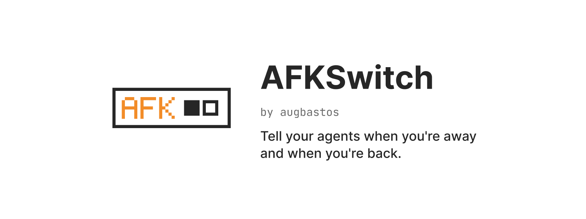
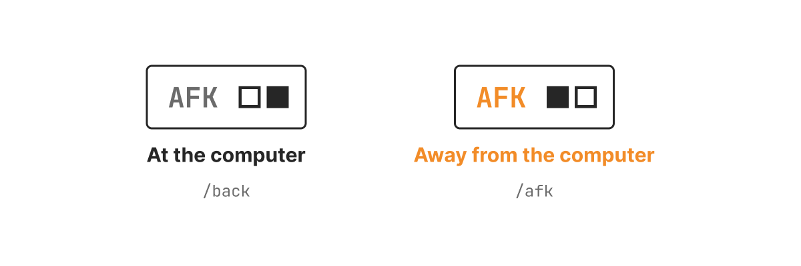
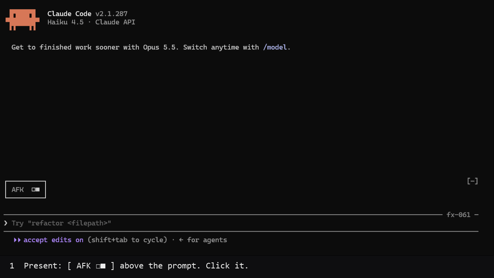

# AFKSwitch

<picture>
  <source media="(prefers-color-scheme: dark)" srcset="assets/readme/hero-dark.png">
  
</picture>

[](https://github.com/augbastos/afkswitch/actions/workflows/ci.yml)
[](LICENSE)
[](https://github.com/augbastos/afkswitch/releases)

**AFKSwitch by augbastos** — Tell your agents when you're away and when you're back.

AFKSwitch is a presence plugin for coding agents: mark yourself away, then return
to collect status where the host supports it. Presence is not permission.

## Status

Full support in Claude Code. Codex, Hermes Agent, Cursor, GitHub Copilot CLI and
Antigravity hear your presence through hooks the [installer](#every-agent-on-this-machine)
wires; those hooks are tested with synthetic input, not yet in each live host.
See [compatibility](#compatibility-at-a-glance).

### Compatibility at a glance

Capabilities from [the adapter matrix](adapters/capabilities.json):

| Host | State | Sync | Notify peers | Collect return status | Visual switch |
|---|---|---|---|---|---|
| Claude Code | yes | yes | yes | yes | terminal and desktop app, with modules |
| Codex | yes | each prompt and tool call, via hooks (not live-verified) | no | no | no |
| Hermes Agent | yes | each model call while away, via a hook (not live-verified) | no | no | no |
| Cursor | yes | new sessions while away, via a hook (not live-verified) | no | no | no |
| GitHub Copilot CLI | yes | new sessions while away, via a hook (not live-verified) | no | no | no |
| Antigravity CLI | yes | each model call while away, via a hook (not live-verified) | no | no | no |
| Generic local agent (Ollama and others) | yes | before each turn, if the host calls the helper | no | no | no |

**Only Claude Code tells running sessions at once.** Every other agent learns at its next
hook, and none of their hooks is verified in a live host yet. See
[tested versions and limits](docs/compatibility.md).

## What it does

```text
/afk [optional context]     I'm physically away
/back [optional context]    I'm physically present again
```

In Claude Code, `/afk` saves your presence and tells the live local sessions the host
can reach; the report names any it could not reach. Authorized work continues, and
only steps that need you wait. `/back` collects a summary with what needs you first,
then what got done. Optional context is information, never permission; `/back` context
belongs to that return event and is not saved in the state file.

While AFK, sessions keep a durable decision queue and record reversible choices within
existing authorization. Independent authorized work continues. At the next natural pause
after `/back`, each session presents all queued decisions together as multiple-choice
questions, recommended option first, then resumes asking in real time.

Click the terminal switch to save the same state without context. The click takes effect at
once, even mid-turn, and tells every live local session right away with the same message
`/afk` or `/back` sends. Use the slash commands when you also want a note.

<picture>
  <source media="(prefers-color-scheme: dark)" srcset="assets/readme/states-dark.png">
  
</picture>

### What the switch runs by itself

The switch is a Claude Code mod (`hooks/switch.tsx`). It does these things and nothing else:

- **One state write per click.** A click runs the bundled state helper (`afk` when you are
  present, `back` when you are away) once, with `python3`, `python` or `py -3`, whichever
  starts first. It never runs anything without a click. A slash command would wait until
  the session is idle; the helper does not.
- **One notice per live session, after a click that changed the state.** It lists sessions
  with `ListAgents` and sends each live local interactive one (never Remote Control or cloud)
  the message the `/afk` or `/back` skill sends, read from that skill's `references/message.md`.
  It goes through the host's own session messaging, not the network.
- **One line in this session's transcript per changed click**, `/afkswitch:afk` or
  `/afkswitch:back`, and the same message for this session's model, so the turn already
  running keeps going with the AFK guidance instead of waiting for you.
- **It reads `HOME` or `USERPROFILE`** only to find `~/.afkswitch/state.json`
  (`AFKSWITCH_STATE_DIR` overrides the folder). These are folder paths, not credentials.
- **Two short timers** blink and then hide the idle label; nothing polls.

The three rules the plugin follows (one writer, explicit actions only, presence is not
permission) are in [details](docs/details.md#three-rules).

## Requirements

- `python3` (Python 3.9+) on `PATH`.
- For the switch: a Claude Code build with function hooks.
- On Windows, check that `python3 --version` answers: the Python install manager from
  python.org provides `python3`, the older classic installer provides only `python`.

AFKSwitch is a Claude Code Mod, live-tested on **2.1.287 on Windows**.
The [compatibility record](docs/compatibility.md) distinguishes local-marketplace
module loading from live clicks and peer notification.

## Install

For Claude Code:

```text
/plugin marketplace add augbastos/afkswitch
/plugin install afkswitch@afkswitch
/reload-plugins
```

If your build does not load installed mods, use the [local clone](#local-clone).
See [switch setup and behavior](docs/details.md#claude-code-visual-switch) for details.

### Local clone

```sh
git clone https://github.com/augbastos/afkswitch.git
claude --plugin-dir ./afkswitch
```

### Every agent on this machine

From a clone or the downloaded plugin folder (Python 3.9+), one command finds the agents
you have and wires each one to the same presence. It shows every change first, backs up
each file it edits and asks before writing.

```text
python scripts/install.py --dry-run      # show what would change
python scripts/install.py                # review the changes, then confirm
python scripts/install.py --host claude  # only some agents
python scripts/install.py --uninstall    # remove everything it added
```

It also installs the `afkswitch` command, for any terminal or an OS keyboard shortcut:

```text
afkswitch afk [--context TEXT]   # away
afkswitch back                   # here again
afkswitch status                 # one line: AFK since 14:02 (2h 5m) · "sleep" · g31
```

[Installer details](docs/details.md#installer), per agent and on removal.

### Codex

```text
codex plugin marketplace add https://github.com/augbastos/afkswitch
codex plugin add afkswitch@afkswitch
```

Use `$afkswitch:afk` and `$afkswitch:back`. The plugin adds no hooks; the
[installer](#every-agent-on-this-machine) does. Codex's default sandbox keeps the skills
from writing the state folder: use the `afkswitch` command, or see
[Codex sandbox setup](docs/details.md#codex-sandbox).

## Try it in 30 seconds

1. Open two Claude Code sessions in two terminals with AFKSwitch loaded.
2. Click the switch in one session to set AFK.
3. Watch the other session get told and continue its authorized work.
4. Click again to return and collect status.



## Test

Run from the repo root. Python 3.9 or newer; `pytest` is required; `jsonschema` is optional and enables the schema checks.

```text
python scripts/validate.py
python -m pytest conformance -q -p no:cacheprovider
```

CI installs pinned dependencies from `.github/ci/requirements.txt` and runs
`python scripts/test_ci.py`, which runs every conformance module in a separate
process with its own temporary directory, using at most one process per CPU.
The OS and Python support matrix stays in `.github/workflows/ci.yml`.
The required checks are `Safety` and `CI passed`. `Safety` scans PR commits for
secrets and checks critical paths against the base revision's policy. `CI passed`
requires every job to succeed; only `Safety` may be skipped outside pull requests.

On a Claude Code build with function hooks, `claude plugin test .` runs the switch module
tests. The opt-in model evals in [`evals/`](evals/README.md) are not part of CI.
See [conformance](conformance/README.md) for what each check proves.

## Layout

| Path | What is in it |
|---|---|
| `skills/` | The `afk` and `back` skills and the bundled state helper |
| `hooks/` | Sync hooks and the Claude Code switch module (`switch.tsx`) |
| `adapters/` | Capability matrix and per-host adapters (generic, Antigravity) |
| `spec/` | The portable presence specification |
| `conformance/` | Model-independent tests and checker |
| `evals/` | Opt-in local model evals |
| `scripts/` | Validator, packager, logo generator and the sync hook script |
| `docs/` | Details, compatibility record, history |
| `assets/` | Logos and README pictures |
| `.claude-plugin/`, `.codex-plugin/`, `plugin.json` | Plugin manifests |

## Configuration

| Variable | Effect |
|---|---|
| `AFKSWITCH_STATE_DIR` | Folder that holds `state.json` instead of `~/.afkswitch` |
| `AFKSWITCH_KEEP_PROMPTS=1` | Keep Claude Code approval prompts open while you are away |

## What AFKSwitch reads, writes, and sends

**Privacy:** state stays local in `~/.afkswitch/state.json`, or in `state.json` under
`AFKSWITCH_STATE_DIR` when set. It contains status, time, optional AFK context, and a
change counter. The helper briefly creates a lock while writing. If the old state
contains malformed content and its bytes can be read, the helper copies it to
`state.json.corrupt-<time>` before replacing it. If the file cannot be read, the
transition fails and the file stays intact.

AFKSwitch runs no server and makes no network requests of its own. Messages between
sessions travel through the host's own mechanisms and are governed by the host.

Read-only sync hooks (session start, each prompt and, in Claude Code, each tool call)
inspect state and a bounded session transcript tail, then exit.
A third read-only hook declines Claude Code's approval prompts while you are away.
The switch reads presence from state. While you are away it also matches your context
against a short word list to draw a label such as `💤 sleeping` beside it; the text itself
is never drawn. There is no daemon, polling, account, or telemetry.
Claude Code peer messages can include your optional context; host data handling applies.

The installer writes only after showing you every change: it copies AFKSwitch to a folder
of its own, adds its hook entries to each chosen agent's config file (backing the file up
first) and records what it did so `--uninstall` removes exactly that.

Read the [Privacy policy](PRIVACY.md) and [Security policy](SECURITY.md).

## How it works

Claude Code syncs presence at session start and prompt submission. The switch
re-reads state on host events. See [lifecycle sync](docs/details.md#lifecycle-sync),
[switch mechanics](docs/details.md#claude-code-visual-switch), and the
[presence specification](spec/presence.md).

## Links

[Changelog](CHANGELOG.md) · [Details and usage](docs/details.md) ·
[Compatibility](docs/compatibility.md) · [Presence specification](spec/presence.md) ·
[Writing an adapter](adapters/README.md) · [Conformance tests](conformance/README.md) ·
[Support](SUPPORT.md) · [Contributing](CONTRIBUTING.md)

## Licence

MIT. See [LICENSE](LICENSE).
