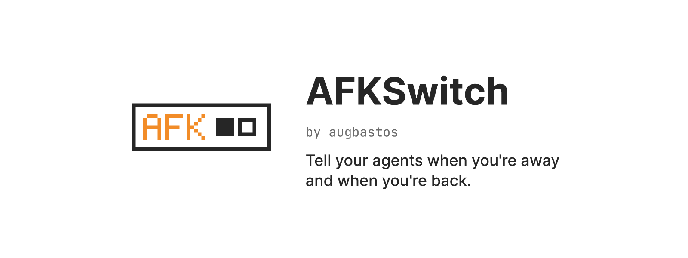
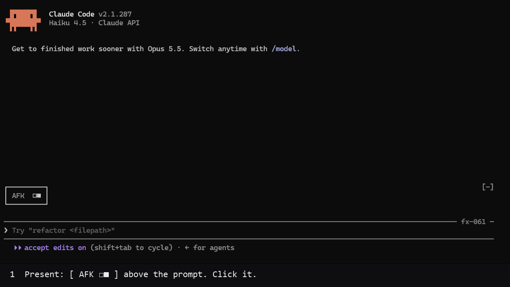

# AFKSwitch

<picture>
  <source media="(prefers-color-scheme: dark)" srcset="assets/readme/hero-dark.png">
  
</picture>

**AFKSwitch by augbastos** — Tell your agents when you're away and when you're back.

AFKSwitch is a presence plugin for coding agents: mark yourself away, then return
to collect status where the host supports it. Presence is not permission.

Authorized work continues while you're away; steps that need you wait. In Claude Code,
returning collects status with your blockers first, followed by completed work.

Full support in Claude Code; Codex and Antigravity are state-only.
See [compatibility](#compatibility-at-a-glance).

## Install

For Claude Code:

```text
/plugin marketplace add augbastos/afkswitch
/plugin install afkswitch@afkswitch
/reload-plugins
```

Needs `python3` (Python 3.9+) on `PATH`; the terminal switch needs Claude Code
function hooks. AFKSwitch is a Claude Code Mod, live-tested on **2.1.287 on Windows**.
The [compatibility record](docs/compatibility.md) distinguishes local-marketplace
module loading from live clicks and peer notification.

If your build does not load installed mods, use the [local clone](#local-clone).
See [switch setup and behavior](docs/details.md#claude-code-visual-switch) for details.

### Try it in 30 seconds

1. Open two Claude Code sessions in two terminals with AFKSwitch loaded.
2. Click the switch in one session to set AFK.
3. Watch the other session get told and continue its authorized work.
4. Click again to return and collect status.

```text
[ AFK  □■ ]  you're here
[ AFK  ■□ ]  you're away
```



### Trust

- MIT licensed.
- Presence is stored in a local state file.
- AFKSwitch itself has no server, account, telemetry, or network requests;
  peer messages use the host's transport and data handling.
- Presence is not permission.
- One writer: the bundled state helper.
- Explicit transitions only: a click or `/afk` / `/back`.

## Compatibility at a glance

Capabilities from [the adapter matrix](adapters/capabilities.json):

| Host | State | Sync | Notify peers | Collect return status | Visual switch |
|---|---|---|---|---|---|
| Claude Code | yes | yes | yes | yes | terminal, with modules |
| Codex | yes | no | no | no | no |
| Antigravity CLI | yes | no | no | no | no |
| Generic local agent | yes | before each turn, if the host calls the helper | no | no | no |

**Codex and Antigravity are state-only.** Their experimental hook files have no
default wiring or verified live-host sync. See [Codex installation](#codex) and
[tested versions and limits](docs/compatibility.md).

## What it does

```text
/afk [optional context]     I'm physically away
/back [optional context]    I'm physically present again
```

In Claude Code, `/afk` saves your presence and tells the live local sessions the host
can reach; the report names any it could not reach. Authorized work continues, and
only steps that need you wait. `/back` collects a summary with what needs you first,
then what got done. Optional context is information, never permission; `/back` context
belongs to that return event and is not saved in the state file.

Click the terminal switch to run the same skills without context. Each invocation
starts a model turn; the host's permissions and costs still apply.

## Three rules

1. **One writer: the helper.** Only the bundled helper saves presence. The switch and
   sync hooks read it; peers are notified only after a successful save and read-back.
2. **Explicit actions only.** Only `/back` ends AFK, including through the switch.
   Time passing, a remote reply, or a session restart never means you returned.
3. **Presence is not permission.** Away does not mean unreachable or authorize new
   actions. Only the step that needs you waits; independent authorized work continues.

## What AFKSwitch reads, writes, and sends

**Privacy:** state stays local in `~/.afkswitch/state.json`, or in `state.json` under
`AFKSWITCH_STATE_DIR` when set. It contains status, time, optional AFK context, and a
change counter. The helper briefly creates a lock while writing. If the old state
contains malformed content and its bytes can be read, the helper copies it to
`state.json.corrupt-<time>` before replacing it. If the file cannot be read, the
transition fails and the file stays intact.

AFKSwitch runs no server and makes no network requests of its own. Messages between
sessions travel through the host's own mechanisms and are governed by the host.

Read-only sync hooks inspect state and a bounded session transcript tail, then exit.
The switch reads presence from state. There is no daemon, polling, account, or telemetry.
Claude Code peer messages can include your optional context; host data handling applies.

Read the [Privacy policy](PRIVACY.md) and [Security policy](SECURITY.md).

## Other installation options

### Local clone

```sh
git clone https://github.com/augbastos/afkswitch.git
claude --plugin-dir ./afkswitch
```

### Codex

```text
codex plugin marketplace add https://github.com/augbastos/afkswitch
codex plugin add afkswitch@afkswitch
```

Use `$afkswitch:afk` and `$afkswitch:back`. The state folder must be writable;
see [Codex sandbox setup](docs/details.md#codex-sandbox).

## How it works

Claude Code syncs presence at session start and prompt submission. The switch
re-reads state on host events. See [lifecycle sync](docs/details.md#lifecycle-sync),
[switch mechanics](docs/details.md#claude-code-visual-switch), and the
[presence specification](spec/presence.md).

## Links

[Changelog](CHANGELOG.md) · [Details and usage](docs/details.md) ·
[Compatibility](docs/compatibility.md) · [Presence specification](spec/presence.md) ·
[Writing an adapter](adapters/README.md) · [Conformance tests](conformance/README.md) ·
[Support](SUPPORT.md) · [Contributing](CONTRIBUTING.md) · [MIT license](LICENSE)
